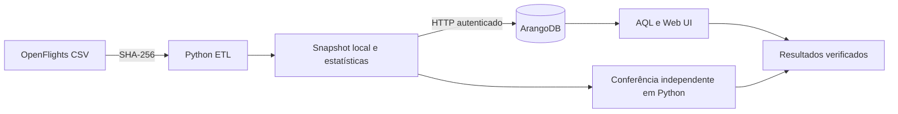
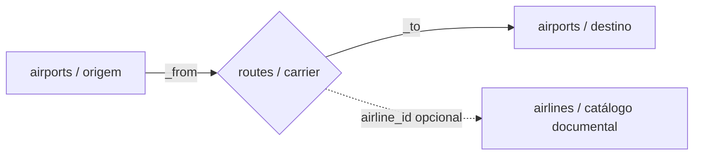

# Modelo e integridade

| Coleção | Tipo | Identidade e atributos |
|---|---|---|
| `airports` | Documento e conjunto de vértices | `_key` é o ID OpenFlights. Nome, cidade, país, IATA, ICAO e coordenadas |
| `airlines` | Documento auxiliar | `_key` é o ID OpenFlights. Nome, códigos, país e situação registrada no catálogo |
| `routes` | Aresta | `_from` e `_to` apontam para `airports/<id>`. `carrier` guarda a identidade observada, `airline_id` o vínculo opcional com o catálogo e os arrays guardam códigos, codeshare e equipamento |

`flight_network` é um General Graph dirigido. Duas companhias podem ligar o mesmo par no mesmo sentido. A identidade de aresta é `(origem, destino, companhia)` e a chave é um hash determinístico dessa tupla. O ETL reúne valores distintos de metadados se a mesma identidade aparecer mais de uma vez. O país de `airlines` e a marca de atividade descrevem o catálogo auxiliar. As chaves da fonte prevalecem sobre códigos, que podem estar faltando ou ser alterados ao longo do tempo.

O ArangoDB cria índices primários e índices de aresta. O índice persistente em `[country, iata]` atende à consulta de aeroportos brasileiros. O índice persistente único em `[_from, _to, carrier]` preserva a identidade de negócio. Não há valor de desempenho inferido desses índices.

A importação por coleção de documentos passa pela checagem de todas as referências no Python. Primeiro são enviados aeroportos e companhias, depois as arestas. Os lotes usam `complete=true` e ignoram chaves existentes para permitir reexecução. A verificação confronta cada documento persistido com o snapshot, excluindo metadados internos gerados pelo servidor. AQL reaudita referências, loops e identidades duplicadas. Para escritas operacionais, Gharial verifica o tipo e a presença dos extremos e remove arestas incidentes ao remover vértices. O CRUD em AQL escreve apenas no banco de ensaio, verifica o par antes da exclusão e remove a aresta e o vértice na mesma consulta.

As interfaces e os índices estão descritos na documentação oficial. [Grafos](https://docs.arango.ai/arangodb/3.12/graphs/) · [Índices](https://docs.arango.ai/arangodb/3.12/indexes-and-search/indexing/basics/) · [Importação](https://docs.arango.ai/arangodb/3.12/develop/http-api/import/).
